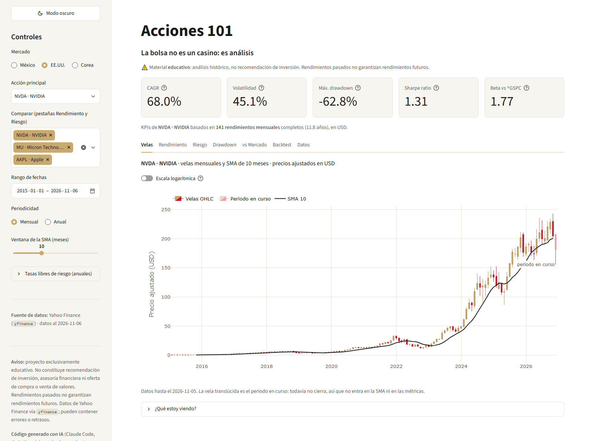

# Acciones 101

Dashboard educativo en Streamlit para analizar acciones de México, EE.UU. y Corea con periodicidad mensual o anual: la bolsa no es un casino, es análisis.

**App publicada:** _pendiente: pega aquí la liga de Streamlit Community Cloud._



> **Aviso:** Este proyecto es exclusivamente **educativo**. No constituye recomendación de inversión, asesoría financiera ni oferta de compra o venta de valores. Rendimientos pasados no garantizan rendimientos futuros. Cada persona es responsable de sus propias decisiones de inversión. Los datos provienen de Yahoo Finance a través de `yfinance` y pueden contener errores o retrasos.

> **Código generado con IA:** Todo el código de este repositorio fue escrito por un agente de IA (Claude Code, de Anthropic) a partir de las instrucciones de `CLAUDE.md`, y revisado por el autor con fines didácticos.

## Contenido

1. [Qué muestra el dashboard](#qué-muestra-el-dashboard)
2. [Instalación local](#instalación-local)
3. [Cómo agregar un ticker](#cómo-agregar-un-ticker)
4. [Cómo agregar una nueva métrica: el Sortino ratio](#cómo-agregar-una-nueva-métrica-el-sortino-ratio)
5. [Cómo cambiar parámetros](#cómo-cambiar-parámetros)
6. [Respaldo CSV](#respaldo-csv)
7. [Usar los datos en Looker Studio, Power BI o Tableau](#usar-los-datos-en-looker-studio-power-bi-o-tableau)
8. [Publicar en Streamlit Community Cloud](#publicar-en-streamlit-community-cloud)
9. [Estructura del repositorio](#estructura-del-repositorio)
10. [Limitaciones](#limitaciones)
11. [Licencia y créditos](#licencia-y-créditos)

## Qué muestra el dashboard

Compara 10 acciones (6 de México, 3 de EE.UU. y 1 de Corea) contra el benchmark de su mercado: S&P/BMV IPC (`^MXX`), S&P 500 (`^GSPC`) o KOSPI (`^KS11`). Todo se calcula en la moneda local de cada activo, con precios **ajustados** por splits y dividendos.

La barra lateral controla la acción principal, los tickers a comparar, el rango de fechas, la periodicidad (Mensual o Anual), la ventana de la SMA, la tasa libre de riesgo de cada moneda y el **modo claro u oscuro**. Arriba aparecen cinco KPIs de la acción principal; debajo, siete pestañas, cada una con un desplegable «¿Qué estoy viendo?» que explica la gráfica, su fórmula y una pregunta para reflexionar:

| Pestaña | Qué tiene |
|---|---|
| «Velas» | Velas OHLC con la línea SMA; el periodo en curso aparece translúcido y con la etiqueta "periodo en curso". |
| «Rendimiento» | Cuánto valdrían 10,000 invertidos el mismo día en cada ticker. Abre en escala logarítmica. |
| «Riesgo» | Volatilidad vs CAGR de todas las acciones y benchmarks, más una tabla con todas las métricas. |
| «Drawdown» | Precio con su máximo previo, caídas desde ese máximo y tiempo de recuperación. |
| «vs Mercado» | Dos acciones lado a lado contra su benchmark: crecimiento, dispersión con la recta de regresión (beta) y tarjetas. |
| «Backtest» | Regla SMA contra buy & hold, sin información del futuro. Admite benchmarks como activo. |
| «Datos» | Vista previa de la tabla tidy y botón para descargar el CSV. |

### Las 6 métricas

Son las mismas 6 de la presentación de la clase. Notación: `P_t` es el precio de cierre ajustado del periodo *t*; `r_t = P_t / P_{t−1} − 1` es el rendimiento simple; `k` es el número de periodos por año (12 en Mensual, 1 en Anual); `r_f = (1 + tasa_anual)^(1/k) − 1` es la tasa libre de riesgo por periodo; `C` es el capital inicial (10,000). Todas las fórmulas están escritas a mano en [`metricas.py`](metricas.py).

| Métrica | Pregunta que responde | Fórmula | Cómo se interpreta | Pestaña del dashboard | Columna en el CSV (`metrica`) |
|---|---|---|---|---|---|
| **1. Velas + SMA** | ¿Cómo se movió el precio en cada periodo y cómo se compara con su promedio reciente? | Vela: `open` = primer precio del periodo, `high` = máximo, `low` = mínimo, `close` = último. `SMA_t = (P_t + P_{t−1} + … + P_{t−n+1}) / n` | Vela dorada: el periodo cerró arriba de su apertura; roja: abajo. Si el precio está sobre su SMA, vale más que su promedio de los últimos *n* periodos. | «Velas» | `precio_cierre`, `sma_<n>` (por ejemplo `sma_10`) |
| **2. Rendimiento acumulado** | Si hubiera invertido el mismo día en cada activo, ¿cuánto valdría después? | `R_t = (1 + r_1)(1 + r_2)…(1 + r_t) − 1`; valor de la inversión `V_t = C × (1 + R_t)` | Los rendimientos se multiplican (interés compuesto). +300 % significa que la inversión se multiplicó por 4. En escala logarítmica, pendientes iguales = misma tasa de crecimiento. | «Rendimiento» | `rendimiento`, `rendimiento_acumulado`, `valor_inversion` |
| **3. CAGR y volatilidad** | ¿A qué ritmo anual creció y qué tanto se movió en el camino? | `CAGR = (P_final / P_inicial)^(1/años) − 1`, con `años = n_periodos / k`; `σ_anual = σ(r) × √k` | CAGR de 15 % = como si hubiera crecido 15 % cada año. Más volatilidad = resultados más inciertos (cuenta igual subidas y bajadas). Lo deseable: arriba y a la izquierda. | «Riesgo» y KPIs | `cagr`, `volatilidad_anualizada` |
| **4. Drawdown** | ¿Cuál fue la peor caída desde un máximo y cuánto tardó en recuperarse? | `DD_t = P_t / máx(P_0, …, P_t) − 1`; máx. drawdown `= mín_t DD_t` | −50 % es lo que perdió quien compró en el pico; para recuperarse necesitó +100 %. 0 % = el precio está en su máximo histórico. | «Drawdown» y KPI | `drawdown`, `max_drawdown` |
| **5. Benchmark, beta y Sharpe** | ¿Se movió con su mercado, más o menos que él, y cuánto rendimiento extra dio por cada unidad de riesgo? | `β = Cov(r_a, r_m) / Var(r_m)`; correlación `= Cov(r_a, r_m) / (σ_a · σ_m)`; `Sharpe = media(r − r_f) / σ(r) × √k` | β = 1.5: amplificó 1.5 veces los movimientos del benchmark; β < 1: los amortiguó. Si la correlación es baja, la beta explica poco. Sharpe > 1 suele considerarse bueno; ≈ 0 = no ganó más que la tasa libre de riesgo. | «vs Mercado», «Riesgo» y KPIs | `beta`, `correlacion`, `sharpe` |
| **6. Backtest SMA vs buy & hold** | ¿Una regla simple con la SMA habría reducido las caídas, y a qué costo en rendimiento? | `señal_t = 1 si P_{t−1} > SMA_{t−1}, si no 0`; `r_regla_t = señal_t × r_t + (1 − señal_t) × r_f`; buy & hold usa `r_t` siempre | La regla decide con el cierre del periodo **anterior** (sin información del futuro). Se comparan CAGR, máx. drawdown, Sharpe y % del tiempo invertido. Sin comisiones ni impuestos; rendimientos pasados no garantizan futuros. | «Backtest» | No se exporta: se calcula en la pestaña |

Debajo de los KPIs se indica cuántos rendimientos se usaron (N). Con menos de 24 aparece el aviso **"pocas observaciones: estimación inestable"**. En Anual casi siempre aplica: de 2015 a hoy solo hay unos 10 rendimientos anuales.

## Instalación local

Requiere **Python 3.12 o más reciente** (numpy 2.5.4 no instala en versiones anteriores).

```bash
git clone <url-de-tu-repo> acciones-101
cd acciones-101
python -m venv .venv
# Windows (PowerShell):  .venv\Scripts\Activate.ps1
# macOS / Linux:         source .venv/bin/activate
pip install -r requirements.txt
streamlit run app.py
```

La app se abre en `http://localhost:8501`. Para correr las pruebas de las fórmulas:

```bash
pytest
```

> Si el repositorio vive en una carpeta sincronizada (Dropbox, OneDrive, iCloud), excluye `.venv/` de la sincronización: el programa de sincronización puede bloquear archivos mientras `pip` instala.

## Cómo agregar un ticker

Ejemplo: agregar Microsoft (`MSFT`), que se compara contra el S&P 500.

**1. Agrégalo a `TICKERS` en [`config.py`](config.py):**

```python
TICKERS: dict[str, dict[str, str]] = {
    # ...
    "AAPL":        {"nombre": "Apple",             "mercado": "EE.UU.", "moneda": "USD", "benchmark": "^GSPC"},
    "MSFT":        {"nombre": "Microsoft",         "mercado": "EE.UU.", "moneda": "USD", "benchmark": "^GSPC"},
    # ...
}
```

**2. Verifica que Yahoo Finance lo encuentre** (usa la misma función de descarga que la app):

```bash
python -c "import datos; print(datos.descargar_precios(['MSFT'], '2024-01-01').tail())"
```

Si sale una tabla con fechas y precios, funciona. Si sale `Empty DataFrame` y el mensaje `possibly delisted; no timezone found`, el símbolo no existe con ese nombre en Yahoo Finance. Búscalo en [finance.yahoo.com](https://finance.yahoo.com): las emisoras mexicanas terminan en `.MX` e incluyen la serie (`AMXB.MX`, `GMEXICOB.MX`), y las coreanas terminan en `.KS` (`000660.KS`).

**3. Regenera el respaldo** para que el nuevo ticker también funcione si Yahoo Finance falla:

```bash
python actualizar_respaldo.py
git add config.py data/respaldo_precios.csv
git commit -m "Agrega MSFT"
```

Al abrir la app, `MSFT · Microsoft` aparece en la barra lateral dentro del mercado EE.UU.

**Si el ticker es de un mercado nuevo** (por ejemplo, Brasil), además:

- agrega su índice a `BENCHMARKS` (por ejemplo `"^BVSP": {"nombre": "Ibovespa", "moneda": "BRL"}`);
- agrega la tasa libre de riesgo de la moneda nueva a `TASAS_LIBRE_RIESGO`, con instrumento, fuente, URL y fecha;
- agrega un color para el mercado en `COLORES_MERCADO`, en los dos modos (claro y oscuro).

## Cómo agregar una nueva métrica: el Sortino ratio

El **Sortino ratio** es como el Sharpe ratio, pero solo cuenta como riesgo los periodos que rindieron menos que la tasa libre de riesgo: una subida fuerte no se castiga. El ejemplo sigue el mismo camino que cualquier métrica nueva: fórmula → prueba → resumen → CSV → KPI. Este código se probó en una copia del repositorio: las pruebas pasan y la app muestra el sexto KPI.

**1. La función, en [`metricas.py`](metricas.py)**, justo después de `sharpe`. Lleva type hints y un docstring en español con la fórmula y su interpretación:

```python
def sortino(rend: pd.Series, tasa_libre_anual: float, periodos_por_anio: int) -> float:
    """Sortino ratio anualizado: como el Sharpe ratio, pero solo castiga las caídas.

    Fórmula:
        exceso_t = r_t − r_f
        σ_baja = √( media( min(exceso_t, 0)² ) )      (downside deviation)
        Sortino = [media(exceso_t) / σ_baja] × √periodos_por_anio

    Interpretación:
        El Sharpe ratio trata igual una subida fuerte que una caída fuerte:
        las dos aumentan σ. El Sortino solo cuenta como riesgo los periodos que
        rindieron menos que la tasa libre de riesgo. Si es mucho mayor que el
        Sharpe ratio, buena parte de la volatilidad fue "hacia arriba".

    Args:
        rend: Rendimientos simples por periodo.
        tasa_libre_anual: Tasa libre de riesgo anual en decimal.
        periodos_por_anio: 12 en mensual, 1 en anual.

    Returns:
        Sortino ratio anualizado. ``NaN`` si hay menos de 2 rendimientos o
        ningún periodo rindió menos que la tasa libre de riesgo.

    Example:
        >>> round(sortino(pd.Series([0.03, -0.01, 0.03, -0.01]), 0.0, 1), 4)
        1.4142
    """
    rend = _limpiar(rend)
    if len(rend) < 2:
        return math.nan
    exceso = rend - tasa_por_periodo(tasa_libre_anual, periodos_por_anio)
    desviacion_baja = math.sqrt(float((exceso.clip(upper=0) ** 2).mean()))
    if desviacion_baja < _EPSILON:
        return math.nan
    return float(exceso.mean()) / desviacion_baja * math.sqrt(periodos_por_anio)
```

**2. Las pruebas, al final de [`tests/test_metricas.py`](tests/test_metricas.py)**, con casos de resultado conocido:

```python
def test_sortino_caso_conocido() -> None:
    # Exceso medio = 0.01; σ_baja = √((0.01² + 0.01²) / 4) ≈ 0.00707  →  Sortino = √2
    rend = pd.Series([0.03, -0.01, 0.03, -0.01])
    assert metricas.sortino(rend, 0.0, 1) == pytest.approx(math.sqrt(2))


def test_sortino_sin_caidas_es_nan() -> None:
    # Si ningún periodo rinde menos que la tasa libre, no hay riesgo "a la baja" que medir.
    assert math.isnan(metricas.sortino(pd.Series([0.02, 0.03, 0.01]), 0.0, 12))
```

Corre `pytest` y verifica que las pruebas nuevas pasen antes de seguir.

**3. Inclúyela en `resumen_metricas`** (en `metricas.py`), en dos lugares: el valor inicial y el cálculo, junto al Sharpe ratio. Así respeta la regla de los 2 años mínimos:

```python
    resultado: dict = {
        # ...
        "sharpe": math.nan,
        "sortino": math.nan,          # ← nuevo
        # ...
    }
    # ...
    resultado["sharpe"] = sharpe(rend, tasa_libre_anual, periodos_por_anio)
    resultado["sortino"] = sortino(rend, tasa_libre_anual, periodos_por_anio)   # ← nuevo
```

**4. Agrégala a `tabla_tidy_para_bi`** (en `metricas.py`) para que llegue al CSV de la pestaña «Datos»:

```python
        resumen_series = pd.Series({
            # ...
            "sharpe": resumen["sharpe"],
            "sortino": resumen["sortino"],   # ← nuevo
            # ...
        })
```

**5. Muestra el KPI en [`app.py`](app.py)**: cambia la fila de 5 columnas por 6 y agrega la tarjeta después de la de beta. `tarjeta` explica por qué falta el valor si sale `NaN`:

```python
k1, k2, k3, k4, k5, k6 = st.columns(6)
# ... tarjetas k1 a k5 sin cambios ...
tarjeta(k6, "Sortino ratio", resumen["sortino"], num(resumen["sortino"]), motivo_nan(resumen, "sortino"),
        "Como el Sharpe ratio, pero solo cuenta como riesgo los periodos que rindieron menos que la tasa libre.")
```

**6. Verifica:** `pytest` en verde y `streamlit run app.py` con el nuevo KPI. Si quieres, agrégala también a la tabla de «Riesgo» (`pestana_riesgo`) y a la tabla de métricas de este README.

## Cómo cambiar parámetros

Desde la **barra lateral** (sin tocar código) se cambian el rango de fechas, la periodicidad, la ventana de la SMA, las tasas libres de riesgo y el modo claro/oscuro. Los valores por defecto viven en [`config.py`](config.py):

| Parámetro | Variable en `config.py` | Valor actual |
|---|---|---|
| Primer día que se descarga | `FECHA_INICIO` | `"2015-01-01"` |
| Acción al abrir la app | `TICKER_DEFAULT` | `"NVDA"` |
| Selección de «Rendimiento» y «Riesgo» | `TICKERS_COMPARAR_DEFAULT` | `["NVDA", "MU", "AAPL"]` |
| Acción de la derecha en «vs Mercado» | `VS_MERCADO_SEGUNDO_DEFAULT` | `"WALMEX.MX"` |
| Periodicidad | `PERIODICIDAD_DEFAULT` | `"Mensual"` (o `"Anual"`) |
| Ventana de la SMA y límites del slider | `VENTANA_SMA_DEFAULT`, `VENTANA_SMA_MIN`, `VENTANA_SMA_MAX` | 10, 3 y 24 periodos |
| Capital de las curvas de crecimiento | `CAPITAL_INICIAL` | 10,000 |
| Umbral del aviso "pocas observaciones" | `MINIMO_OBSERVACIONES` | 24 rendimientos |
| Tasa libre de riesgo por moneda | `TASAS_LIBRE_RIESGO` | MXN, USD y KRW, cada una con fuente y fecha |
| Estilo de velas | `VELAS_ESTILO` | `"up"` (dorado/rojo) o `"clasico"` (verde/rojo) |
| Modo al abrir la app | `MODO_DEFAULT` | `"claro"` (o `"oscuro"`) |
| Colores | `PALETA`, `COLORES_MERCADO` | paleta UP en dos modos |

Notas:

- **Fechas:** si mueves `FECHA_INICIO` antes de 2015, regenera el respaldo (`python actualizar_respaldo.py`); si no, el respaldo no tendrá esos años.
- **Tasa libre de riesgo:** para actualizarla, consulta la fuente indicada en cada moneda y cambia `"tasa"` (en decimal: `0.065` = 6.5 %) y `"fecha"`. En la barra lateral se puede cambiar temporalmente sin tocar el archivo.
- **Variable de entorno `FORZAR_RESPALDO=1`:** obliga a la app a usar el respaldo CSV, como si Yahoo Finance no respondiera (ver la siguiente sección).

## Respaldo CSV

**Por qué existe.** Yahoo Finance a veces no responde o limita las descargas, sobre todo desde servidores en la nube como Streamlit Community Cloud. Para que el demo nunca falle en clase, el repositorio incluye [`data/respaldo_precios.csv`](data/respaldo_precios.csv): precios diarios ajustados de los 13 tickers (10 acciones y 3 benchmarks), en el mismo formato tidy que la descarga (`fecha, ticker, open, high, low, close, volume`). La versión actual tiene 38,568 filas, del 2015-01-02 al 2026-11-05.

**Cómo funciona.** Al abrir la app, `datos.obtener_precios` intenta descargar todo de Yahoo Finance. Si la descarga falla, llega vacía o le faltan tickers, usa el respaldo **solo para lo que falte**. Cuando eso pasa, la app lo dice:

- arriba aparece el aviso **"⚠️ Yahoo Finance no respondió. Mostrando datos de respaldo al ‹fecha›."** (o, si solo faltaron algunos tickers, cuáles vienen del respaldo);
- en la barra lateral, **Fuente de datos** dice si los datos vienen de Yahoo Finance, del respaldo o de ambos, con su fecha.

La fecha de los datos de respaldo es la de su **última actualización**: si lleva meses sin actualizarse, la app mostrará datos de hace meses.

**Cómo actualizarlo** (conviene hacerlo antes de cada clase o de publicar):

```bash
python actualizar_respaldo.py
git add data/respaldo_precios.csv
git commit -m "Actualiza respaldo de precios"
git push
```

El script descarga todos los tickers y benchmarks desde `FECHA_INICIO` hasta hoy e imprime las filas y fechas de cada uno. Si algún ticker no descarga, **no sobrescribe** el respaldo anterior.

**Cómo probarlo** sin esperar a que Yahoo falle:

```bash
# Windows (PowerShell):  $env:FORZAR_RESPALDO = "1"; streamlit run app.py
# macOS / Linux:         FORZAR_RESPALDO=1 streamlit run app.py
```

## Usar los datos en Looker Studio, Power BI o Tableau

**Exportar.** En la pestaña «Datos», el botón **Descargar CSV** baja la tabla tidy con los parámetros que tengas en la barra lateral (periodicidad, rango de fechas, ventana de la SMA y tasas). El nombre del archivo indica la periodicidad y las fechas, por ejemplo `acciones101_mensual_20150101_20261106.csv`. Tiene cuatro columnas:

| Columna | Contenido |
|---|---|
| `fecha` | Fin del periodo (`AAAA-MM-DD`) |
| `ticker` | Acción o benchmark |
| `metrica` | Nombre de la métrica: `precio_cierre`, `drawdown`, `cagr`… |
| `valor` | Valor numérico, en decimal (0.25 = 25 %); vacío si no se pudo calcular |

**Importar:**

- **Looker Studio:** sube el CSV a Google Sheets (*Archivo → Importar*) y en Looker Studio agrega la hoja como fuente de datos (*Añadir datos → Hojas de cálculo de Google*).
- **Power BI:** *Obtener datos → Texto/CSV*. El separador decimal del archivo es el punto: si tu Power BI está en español y lee mal los números, en Power Query cambia el tipo de `valor` a *Número decimal* con *Usar configuración regional → Inglés (Estados Unidos)*.
- **Tableau:** *Conectar → Archivo de texto*.

En las tres, usa `metrica` como filtro o dimensión, `valor` como medida, y `ticker` para el color o los paneles. Las métricas de resumen (`cagr`, `volatilidad_anualizada`, `max_drawdown`, `sharpe`, `beta`, `correlacion`) aparecen una sola vez por ticker, en la última fecha.

**Qué conviene calcular en Python y qué en la herramienta de BI.** Calcula en Python todo lo que depende del **orden en el tiempo**: rendimientos, interés compuesto, máximos acumulados (drawdown), medias móviles, CAGR, volatilidad, Sharpe ratio, beta y backtests. En una herramienta de BI esos cálculos requieren funciones de ventana fáciles de equivocar, y un error ahí no se nota a simple vista. Deja para la herramienta de BI lo que hace bien: filtrar, agrupar, comparar y graficar. Así el número que ves en el tablero es el mismo que validan las pruebas de `tests/`.

## Publicar en Streamlit Community Cloud

1. **Sube el repositorio a GitHub como repositorio público.** Incluye `data/respaldo_precios.csv`; `.venv/` y `BITACORA_AGENTE.md` quedan fuera por `.gitignore`.
2. Entra a [share.streamlit.io](https://share.streamlit.io) e inicia sesión con tu cuenta de GitHub.
3. Presiona **Create app** (en versiones anteriores, **New app**) y elige desplegar una app que ya está en GitHub.
4. Llena los campos: **Repository** = tu repositorio, **Branch** = `main`, **Main file path** = `app.py`.
5. En **Advanced settings**, elige **Python 3.12** o más reciente. Si la app ya se desplegó con otra versión, hay que borrarla y desplegarla de nuevo para cambiarla.
6. Presiona **Deploy**. La primera vez tarda unos minutos porque instala `requirements.txt`.
7. Copia la liga de la app y pégala al inicio de este README.

Cada `git push` a `main` vuelve a desplegar la app. Si en la nube aparece el aviso del respaldo, la app sigue funcionando con los datos del CSV; actualízalo antes de clase (ver [Respaldo CSV](#respaldo-csv)). La app no necesita *secrets* ni claves de API.

## Estructura del repositorio

```
acciones-101/
├── app.py                    # Dashboard en Streamlit (solo presentación)
├── config.py                 # Tickers, benchmarks, fechas, tasas libres de riesgo, paleta
├── datos.py                  # Descarga con yfinance, respaldo CSV y resampling
├── metricas.py               # Las métricas (funciones puras, sin Streamlit)
├── actualizar_respaldo.py    # Regenera data/respaldo_precios.csv
├── data/
│   └── respaldo_precios.csv  # Precios diarios ajustados de todos los tickers
├── tests/
│   └── test_metricas.py      # Pruebas de las fórmulas con casos conocidos
├── docs/
│   └── captura.png           # Captura para este README
├── .streamlit/
│   └── config.toml           # Tema base (colores del modo claro) y color primario
├── pytest.ini                # Configuración de pytest
├── requirements.txt          # Versiones exactas de las dependencias
├── .gitignore
├── CLAUDE.md                 # Instrucciones con las que el agente de IA construyó el repo
├── LICENSE
└── README.md
```

`metricas.py` y `datos.py` no importan Streamlit, y `app.py` no contiene fórmulas. Así cada fórmula se puede probar y reutilizar fuera del dashboard.

## Limitaciones

- **Moneda local, sin tipo de cambio.** Cada activo se analiza en su moneda (MXN, USD o KRW) y solo contra el benchmark de su mercado. Comparar el CAGR de una acción mexicana con el de una estadounidense ignora cuánto cambió el peso frente al dólar.
- **Sesgo de supervivencia.** Las acciones se eligieron hoy, entre empresas grandes que siguen cotizando. Las que quebraron o salieron de la bolsa no aparecen, y eso hace que el pasado se vea mejor de lo que fue.
- **Sin costos ni impuestos.** El backtest no incluye comisiones, impuestos ni diferencias de precio al comprar o vender.
- **Datos de Yahoo Finance.** Pueden tener errores, huecos o retrasos. Los precios ajustados se recalculan hacia atrás cada vez que hay dividendos o splits, así que una cifra puede cambiar ligeramente entre dos descargas.
- **Calidad de datos de AMXB.MX (América Móvil).** En los datos de Yahoo Finance, de 2015 a agosto de 2023 la serie B tiene muchos días **sin volumen** (nadie la operó) y en casi todos se **repite el precio del día anterior**: 829 de 2,978 días en el respaldo al 2026-11-05, y en 824 de ellos el cierre es idéntico al del día previo. Hasta el 16 de marzo de 2023 la serie más operada era la L, que ese día se convirtió en serie B. Los precios repetidos hacen que la acción parezca más estable de lo que fue: **bajan artificialmente la volatilidad** (y tienden a bajar también la beta y la correlación con el IPC). Se conserva como ejemplo de por qué hay que revisar la calidad de los datos; la app muestra el aviso cuando se elige o se incluye.
- **Tasa libre de riesgo constante por moneda.** El Sharpe ratio y el backtest usan una sola tasa por moneda para todo el periodo (el dato más reciente de cada fuente): CETES 28 días para MXN (Banxico), T-bill a 3 meses para USD (FRED, serie DTB3) y la tasa base del Bank of Korea para KRW. En la realidad esas tasas cambiaron mucho desde 2015, así que el Sharpe ratio es una aproximación. No se usa el promedio histórico porque descargar las series de Banxico y del Bank of Korea requiere registrarse y usar una clave de API.
- **Periodo en curso excluido.** El mes o año que todavía no termina no entra en CAGR, volatilidad, Sharpe ratio, drawdown ni backtest. Solo se muestra en «Velas», translúcido y con la etiqueta "periodo en curso".
- **Pocas observaciones en Anual.** Con periodicidad Anual hay unos 10 rendimientos desde 2015. Un solo año extremo mueve mucho la volatilidad, el Sharpe ratio y la beta; por eso los KPIs avisan cuando N < 24.
- **Anualizar con √k es un supuesto.** Multiplicar la volatilidad mensual por √12 supone que los rendimientos de meses distintos son independientes. Por eso la volatilidad anualizada calculada con datos mensuales y la calculada con datos anuales no tienen por qué coincidir.
- **Modo oscuro con CSS.** Streamlit no permite cambiar su tema desde Python en cada sesión, así que el modo oscuro sobrescribe colores con CSS que depende de la estructura interna de Streamlit 1.67. Si actualizas Streamlit, revisa que el modo oscuro se siga viendo bien (por eso las versiones están fijas en `requirements.txt`).

## Licencia y créditos

Código bajo **licencia MIT** (ver [`LICENSE`](LICENSE)).

- **Datos de precios:** Yahoo Finance, a través de la librería [`yfinance`](https://github.com/ranaroussi/yfinance), que no está afiliada a Yahoo. Los datos se usan con fines educativos; para cualquier otro uso, revisa los términos de Yahoo Finance.
- **Tasas libres de riesgo:** Banco de México (SIE), Federal Reserve Bank of St. Louis (FRED) y Bank of Korea. Las ligas exactas están en `config.py`.
- **Librerías:** Streamlit, pandas, NumPy, Plotly y pytest.
- **Diseño:** paleta basada en los colores de la Universidad Panamericana, sin logotipos.
- **Código:** escrito por un agente de IA (Claude Code, de Anthropic) a partir de `CLAUDE.md` y revisado por el autor, como material del curso de visualización de datos y narración de historias de la Universidad Panamericana.
